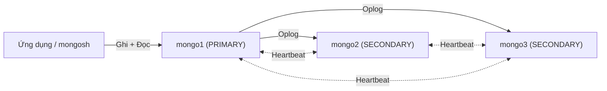

# Hướng dẫn thực hành MongoDB Replication (Replica Set 3 node)

> Mục tiêu: hiểu các kiến thức **cơ bản nhất** của replication trong MongoDB:
> Primary / Secondary, Oplog, Read Preference, Write Concern, Bầu cử (Election) và Failover.

---

## 0. Kiến thức nền tảng

| Khái niệm | Ý nghĩa |
|---|---|
| **Replica Set** | Một nhóm các tiến trình `mongod` lưu **cùng một bộ dữ liệu** để đảm bảo tính sẵn sàng cao (High Availability). |
| **PRIMARY** | Node **duy nhất** nhận thao tác **ghi**. Mặc định cũng là nơi phục vụ thao tác đọc. |
| **SECONDARY** | Node sao chép dữ liệu từ Primary. Mặc định **không cho ghi**, và chỉ cho đọc khi client cho phép rõ ràng. |
| **Oplog** (`local.oplog.rs`) | "Nhật ký thao tác" trên Primary. Secondary đọc oplog và **áp dụng lại** các thao tác để đồng bộ dữ liệu. |
| **Heartbeat** | Các node gửi tín hiệu cho nhau mỗi 2 giây để biết node nào còn sống. |
| **Election** | Khi Primary không phản hồi (mặc định sau ~10 giây), các Secondary **bầu** một Primary mới. |
| **Majority (đa số)** | Cần **> 1/2 số node có quyền bầu** còn sống thì mới bầu được Primary. Với 3 node, cần ít nhất 2. |



Cấu trúc cụm trong bài:

| Container | Hostname | Cổng |
|---|---|---|
| mongo1 | `mongo1` | 27017 |
| mongo2 | `mongo2` | 27018 |
| mongo3 | `mongo3` | 27019 |

> [!NOTE]
> Tên `mongo1`, `mongo2`, `mongo3` chỉ phân giải được **bên trong mạng Docker** (`mongo-cluster`).
> Vì vậy toàn bộ bài thực hành dùng `docker exec ... mongosh` để chạy mongosh bên trong container.

---

## 1. Khởi động 3 node MongoDB

Tại thư mục `cluster/`:

```bash
docker compose up -d
docker compose ps
```

Kết quả mong đợi: 3 container `mongo1`, `mongo2`, `mongo3` ở trạng thái `Up`.

Mỗi node được chạy với lệnh:

```text
mongod --replSet rs0 --bind_ip_all --port <cổng>
```

- `--replSet rs0`: node **sẵn sàng** tham gia replica set tên `rs0`, nhưng **chưa được khởi tạo**.
- `--bind_ip_all`: cho phép các node khác kết nối tới.

Thử kết nối vào `mongo1` trước khi khởi tạo:

```bash
docker exec -it mongo1 mongosh --port 27017
```

```js
rs.status()
```

Kết quả sẽ báo lỗi `no replset config has been received`. Điều này chứng tỏ các node **đang chạy độc lập** và chưa biết đến nhau.

---

## 2. Khởi tạo Replica Set

Vẫn trong mongosh của `mongo1`:

```js
rs.initiate({
  _id: "rs0",
  members: [
    { _id: 0, host: "mongo1:27017", priority: 2 },
    { _id: 1, host: "mongo2:27018", priority: 1 },
    { _id: 2, host: "mongo3:27019", priority: 1 }
  ]
})
```

- `_id: "rs0"` phải **trùng** với giá trị `--replSet`.
- `priority`: node có priority cao hơn sẽ được **ưu tiên** làm Primary. Ở đây `mongo1` có priority 2 để kết quả dễ đoán.

Đợi vài giây rồi nhấn Enter. Dấu nhắc lệnh đổi thành:

```text
rs0 [direct: primary] test>
```

👉 **Kiến thức:** ngay sau `rs.initiate()`, các node tổ chức một **cuộc bầu cử đầu tiên** để chọn Primary.

---

## 3. Xem cấu trúc cluster

### 3.1. Cấu hình replica set: `rs.conf()`

```js
rs.conf()
```

Lệnh này cho xem **cấu hình tĩnh**: danh sách thành viên, `priority`, `votes`, và `settings.electionTimeoutMillis` (mặc định là 10000 ms).

### 3.2. Trạng thái thời gian thực: `rs.status()`

```js
rs.status().members.map(m => ({
  name: m.name,
  state: m.stateStr,
  health: m.health,
  syncFrom: m.syncSourceHost,
  optime: m.optimeDate
}))
```

Kết quả mong đợi:

| name | state | health | syncFrom |
|---|---|---|---|
| mongo1:27017 | PRIMARY | 1 | |
| mongo2:27018 | SECONDARY | 1 | mongo1:27017 |
| mongo3:27019 | SECONDARY | 1 | mongo1:27017 |

- `stateStr`: vai trò hiện tại của node.
- `health: 1`: node còn sống (heartbeat thành công).
- `syncSourceHost`: Secondary đang **sao chép từ node nào**.
- `optimeDate`: thời điểm của thao tác cuối cùng đã được áp dụng. Nếu các node bằng nhau thì dữ liệu đã đồng bộ.

### 3.3. Hỏi nhanh "ai là Primary?": `db.hello()`

```js
db.hello().primary          // "mongo1:27017"
db.hello().isWritablePrimary // true nếu node đang kết nối là Primary
db.hello().hosts            // danh sách thành viên
```

### 3.4. Thông tin Oplog và độ trễ sao chép

```js
rs.printReplicationInfo()           // kích thước oplog, khoảng thời gian oplog lưu được
rs.printSecondaryReplicationInfo()  // mỗi Secondary chậm hơn Primary bao nhiêu giây
```

Thoát mongosh bằng `exit`.

---

## 4. Nhập dữ liệu từ `products.json`

File `products.json` (10 sản phẩm, dạng mảng JSON) đã được gắn vào container `mongo1` tại `/data/import/products.json`.

```bash
docker exec -it mongo1 mongoimport \
  --uri "mongodb://mongo1:27017,mongo2:27018,mongo3:27019/?replicaSet=rs0" \
  --db shop --collection products \
  --jsonArray --file /data/import/products.json
```

Kết quả mong đợi: `10 document(s) imported successfully`.

👉 **Kiến thức:** chuỗi kết nối có `replicaSet=rs0` và liệt kê **nhiều host**. Driver tự **phát hiện** node nào là Primary và gửi lệnh ghi tới đó. Client không cần biết trước Primary là ai.

---

## 5. Truy vấn đọc và ghi trên Primary và Secondary

### 5.1. Trên PRIMARY: đọc và ghi đều được

```bash
docker exec -it mongo1 mongosh --port 27017
```

```js
use shop
db.products.countDocuments()                       // 10
db.products.find({ category: "Audio" }, { _id: 0, product_name: 1, price: 1 })

// GHI trên Primary
db.products.insertOne({
  product_name: "Micro thu âm HyperX QuadCast S",
  price: 3290000,
  stock: 20,
  category: "Streaming",
  created_at: new Date()
})

db.products.updateOne(
  { product_name: "Bàn phím cơ DareU EK87" },
  { $inc: { stock: -5 } }
)
```

#### Quan sát Oplog: dấu vết của các thao tác ghi

```js
use local
db.oplog.rs.find({ ns: "shop.products" }, { op: 1, o: 1, o2: 1, ts: 1 })
  .sort({ $natural: -1 }).limit(3)
```

- `op: "i"` = insert, `op: "u"` = update, `op: "d"` = delete.
- Secondary đọc chính những bản ghi này để **áp dụng lại**, nhờ đó dữ liệu được nhân bản.

#### Write Concern: ghi "an toàn" đến mức nào?

```js
use shop
db.products.insertOne(
  { product_name: "Ghế gaming E-Dra Hercules", price: 2990000, stock: 15, category: "Furniture" },
  { writeConcern: { w: "majority", wtimeout: 5000 } }
)
```

| writeConcern | Ý nghĩa |
|---|---|
| `w: 1` | Chỉ cần Primary ghi xong là xác nhận. Nhanh, nhưng có thể mất dữ liệu nếu Primary sập ngay sau đó. |
| `w: "majority"` | Chờ **đa số node** (2/3) ghi xong mới xác nhận. Đây là **mặc định** từ MongoDB 5.0. An toàn khi xảy ra failover. |

Thoát bằng `exit`.

### 5.2. Trên SECONDARY: ghi bị từ chối, đọc cần cho phép

Kết nối **trực tiếp** vào `mongo2`:

```bash
docker exec -it mongo2 mongosh --port 27018
```

Dấu nhắc: `rs0 [direct: secondary] test>`

**a) Thử GHI, sẽ thất bại:**

```js
use shop
db.products.insertOne({ product_name: "Test ghi trên secondary" })
```

```text
MongoServerError: not primary
```

👉 **Kiến thức:** chỉ **Primary** mới nhận ghi. Nhờ vậy dữ liệu luôn có **một nguồn duy nhất**, không bị xung đột.

**b) Thử ĐỌC (mặc định):**

```js
db.products.find()
```

Với `readPreference` mặc định là `primary`, lệnh có thể bị từ chối với lỗi `NotPrimaryNoSecondaryOk`. Nếu lệnh vẫn chạy được (một số phiên bản mongosh cho phép đọc khi kết nối direct), hãy tiếp tục bước c) để đặt read preference một cách rõ ràng.

**c) Cho phép đọc từ Secondary (Read Preference):**

```js
db.getMongo().setReadPref("secondaryPreferred")
db.products.countDocuments()      // 12: có cả 2 bản ghi vừa insert trên Primary!
db.products.findOne({ product_name: "Micro thu âm HyperX QuadCast S" })
db.products.findOne({ product_name: "Bàn phím cơ DareU EK87" }, { stock: 1 })  // stock = 75
```

👉 **Kiến thức:** dữ liệu ghi trên Primary đã **tự động có mặt** trên Secondary nhờ Oplog.

| readPreference | Đọc từ đâu |
|---|---|
| `primary` (mặc định) | Chỉ Primary. Luôn đọc được dữ liệu mới nhất. |
| `primaryPreferred` | Đọc từ Primary, nếu Primary không có thì đọc từ Secondary. |
| `secondary` | Chỉ Secondary. Giảm tải cho Primary. |
| `secondaryPreferred` | Đọc từ Secondary, nếu không có Secondary thì đọc từ Primary. |
| `nearest` | Đọc từ node có độ trễ mạng thấp nhất. |

> [!WARNING]
> Đọc từ Secondary có thể nhận **dữ liệu cũ** (stale read) vì sao chép là **bất đồng bộ** và có độ trễ (replication lag).

Thoát bằng `exit`.

---

## 6. Minh họa: một node bị sập, rồi truy vấn

Mở **một mongosh kết nối theo kiểu replica set** (không phải direct) từ container `mongo3`. Cửa sổ này dùng để quan sát suốt phần 6:

```bash
docker exec -it mongo3 mongosh "mongodb://mongo1:27017,mongo2:27018,mongo3:27019/shop?replicaSet=rs0"
```

Dấu nhắc: `rs0 [primary] shop>`. Driver đang trỏ tới Primary (`mongo1`).

### 6.1. Làm sập PRIMARY

Mở **một terminal khác** trên máy host:

```bash
docker stop mongo1
```

Quay lại mongosh, đợi khoảng **10–15 giây** rồi xem trạng thái:

```js
rs.status().members.map(m => ({ name: m.name, state: m.stateStr, health: m.health }))
```

Kết quả mong đợi:

| name | state | health |
|---|---|---|
| mongo1:27017 | (not reachable/healthy) | 0 |
| mongo2:27018 | **PRIMARY** | 1 |
| mongo3:27019 | SECONDARY | 1 |

(Primary mới có thể là `mongo2` hoặc `mongo3`.)

👉 **Kiến thức:**
1. Các Secondary không nhận được **heartbeat** từ `mongo1` trong `electionTimeoutMillis` (10 giây).
2. Một Secondary đứng ra ứng cử, và 2/3 node còn sống tạo thành **đa số**, nên **bầu cử thành công**.
3. Đây chính là **Automatic Failover**: hệ thống tự phục hồi mà không cần con người can thiệp.

### 6.2. Truy vấn khi đã mất 1 node

```js
db.hello().primary                 // Primary mới
db.products.countDocuments()       // 12: dữ liệu KHÔNG bị mất

db.products.insertOne({
  product_name: "Tay cầm Xbox Wireless Controller",
  price: 1490000, stock: 50, category: "Gaming Accessories",
  note: "Ghi khi mongo1 đang sập"
})                                  // ghi vẫn THÀNH CÔNG
```

👉 **Kiến thức:** client dùng chuỗi kết nối replica set nên **tự động chuyển** sang Primary mới. Ứng dụng tiếp tục đọc và ghi bình thường.

### 6.3. Node cũ quay lại: tự đồng bộ (catch-up)

```bash
docker start mongo1
```

Sau vài giây, trong mongosh:

```js
rs.status().members.map(m => ({ name: m.name, state: m.stateStr }))
```

- `mongo1` quay lại với vai trò **SECONDARY** trước, rồi đọc oplog để **bắt kịp** bản ghi "Tay cầm Xbox" đã được ghi khi nó vắng mặt.
- Vì `mongo1` có `priority: 2` (cao nhất), sau khi bắt kịp nó sẽ **giành lại vai trò PRIMARY** (priority takeover).

Kiểm tra trực tiếp trên `mongo1`:

```bash
docker exec -it mongo1 mongosh --port 27017 --eval '
  db.getMongo().setReadPref("primaryPreferred");
  db.getSiblingDB("shop").products.findOne({ note: "Ghi khi mongo1 đang sập" })
'
```

### 6.4. (Mở rộng) Sập 2/3 node: mất đa số

```bash
docker stop mongo1 mongo2
```

Trong mongosh (vẫn kết nối từ `mongo3`):

```js
rs.status().members.map(m => ({ name: m.name, state: m.stateStr }))
// mongo3: SECONDARY, KHÔNG còn PRIMARY nào

db.products.insertOne({ product_name: "Thử ghi khi mất đa số" })
// Lỗi / treo rồi timeout: không có Primary để ghi

db.getMongo().setReadPref("secondaryPreferred")
db.products.countDocuments()
// VẪN ĐỌC ĐƯỢC từ Secondary còn sống
```

👉 **Kiến thức:**
- Chỉ còn 1/3 node, **không đủ đa số**, nên **không thể bầu Primary**, và hệ thống chuyển sang **chế độ chỉ đọc**.
- Quy tắc đa số giúp tránh **split-brain** (hai Primary cùng lúc khi mạng bị chia cắt).
- Đây là lý do replica set nên có **số node lẻ** (3, 5, 7...).

Khôi phục:

```bash
docker start mongo1 mongo2
```

---

## 7. Tổng kết

| # | Kiến thức | Minh họa ở bước |
|---|---|---|
| 1 | Replica set = nhiều `mongod` giữ cùng một bộ dữ liệu | 1, 2 |
| 2 | Chỉ **một Primary** nhận ghi, các Secondary sao chép | 3, 5.2a |
| 3 | Sao chép qua **Oplog**, bất đồng bộ | 5.1, 5.2c |
| 4 | **Write Concern** quyết định mức độ an toàn của thao tác ghi | 5.1 |
| 5 | **Read Preference** cho phép đọc từ Secondary (có thể nhận dữ liệu cũ) | 5.2c |
| 6 | **Heartbeat + Election** cho phép tự động failover | 6.1 |
| 7 | Client dùng chuỗi kết nối replica set để tự chuyển sang Primary mới | 6.2 |
| 8 | Node quay lại sẽ tự **catch-up** qua oplog | 6.3 |
| 9 | Cần **đa số** để có Primary, nên dùng số node lẻ | 6.4 |

---

## Phụ lục: Lệnh tiện ích

```bash
# Dừng cụm (giữ dữ liệu)
docker compose down

# Xóa sạch cụm và dữ liệu để làm lại từ bước 1
docker compose down -v

# Xem log của một node (ví dụ để theo dõi quá trình bầu cử)
docker logs -f mongo2 | grep -i -E "election|primary"
```
