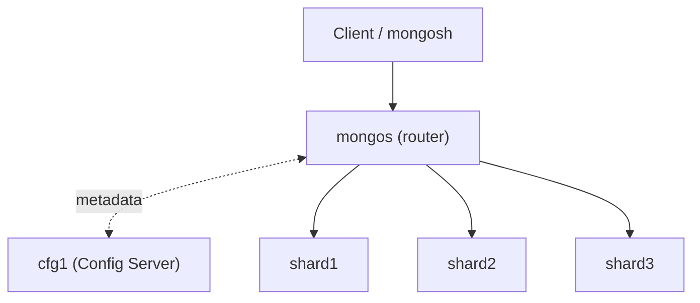

# Hướng dẫn thực hành MongoDB Sharding


## 0. Kiến thức nền tảng

**Replication** = sao chép **cùng** dữ liệu để chịu lỗi (HA).
**Sharding** = **chia nhỏ** dữ liệu ra nhiều máy để **mở rộng ngang** (scale-out).

| Thành phần | Vai trò |
|---|---|
| **Shard** | Giữ **một phần** dữ liệu. Mỗi shard là một replica set. |
| **Config Server** | Lưu **metadata**: chunk nào nằm ở shard nào. |
| **mongos** | **Router**: client chỉ kết nối vào đây. mongos đọc metadata rồi chuyển truy vấn đến đúng shard. |
| **Shard Key** | Trường dùng để quyết định document thuộc về shard nào. |
| **Chunk** | Một khoảng giá trị liên tục của shard key. Đây là đơn vị phân phối và di chuyển dữ liệu giữa các shard. |
| **Balancer** | Tiến trình nền, tự di chuyển chunk để các shard cân bằng. |



Cấu trúc trong bài (cùng mạng `mongo-cluster` với bài Replication):

| Container | Vai trò | Replica set |
|---|---|---|
| cfg1 | Config Server | `cfgRS` |
| shard1, shard2, shard3 | Shard | `shard1RS`, `shard2RS`, `shard3RS` |
| mongos | Router (cổng 27030 trên host) | - |

> [!NOTE]
> Để gọn, mỗi shard chỉ có 1 node. Trong thực tế, mỗi shard **và** config server đều là replica set 3 node.

---

## 1. Khởi động các thành phần

Tại thư mục `cluster/`:

```bash
docker compose --profile sharding up -d
docker compose --profile sharding ps
```

- `--profile sharding` bật thêm `cfg1`, `shard1-3`, `mongos`. Lệnh `docker compose up` thường **chỉ** chạy 3 node của bài Replication.
- `mongos` sẽ tự khởi động lại liên tục (`Restarting`) cho đến khi Config Server được khởi tạo ở bước 2. Đây là hành vi bình thường.

---

## 2. Khởi tạo Sharded Cluster

### 2.1. Khởi tạo Config Server

```bash
docker exec -it cfg1 mongosh
```

```js
rs.initiate({ _id: "cfgRS", configsvr: true, members: [{ _id: 0, host: "cfg1:27017" }] })
```

### 2.2. Khởi tạo từng Shard

Mỗi shard là một container riêng và đều chạy ở cổng **27017** (khác với bài Replication dùng 27017/27018/27019).

| Container | Lệnh chạy trong mongosh của container đó |
|---|---|
| `docker exec -it shard1 mongosh` | `rs.initiate({ _id: "shard1RS", members: [{ _id: 0, host: "shard1:27017" }] })` |
| `docker exec -it shard2 mongosh` | `rs.initiate({ _id: "shard2RS", members: [{ _id: 0, host: "shard2:27017" }] })` |
| `docker exec -it shard3 mongosh` | `rs.initiate({ _id: "shard3RS", members: [{ _id: 0, host: "shard3:27017" }] })` |

> [!WARNING]
> `host` phải trỏ đúng về **chính node** đang chạy lệnh (đúng hostname **và** cổng). Nếu sai, MongoDB báo lỗi `No host described in new configuration ... maps to this node`.

### 2.3. Đăng ký các shard vào cluster (qua mongos)

```bash
docker exec -it mongos mongosh
```

Dấu nhắc: `[direct: mongos] test>`

```js
sh.addShard("shard1RS/shard1:27017")
sh.addShard("shard2RS/shard2:27017")
sh.addShard("shard3RS/shard3:27017")
```

👉 **Kiến thức:** từ đây trở đi, **mọi thao tác đều đi qua mongos**. Client không kết nối trực tiếp vào shard.

---

## 3. Xem cấu trúc cluster

Vẫn trong mongosh của `mongos`:

```js
sh.status()                              // tổng quan: shards, databases, collections, chunks
db.adminCommand({ listShards: 1 }).shards // danh sách shard
sh.getBalancerState()                    // balancer đang bật?
```

`sh.status()` hiển thị 3 shard `shard1RS`, `shard2RS`, `shard3RS` với `state: 1`.

---

## 4. Shard collection và nhập dữ liệu

### 4.1. Range Sharding theo `price`: chia dữ liệu theo khoảng giá

```js
sh.enableSharding("shop")
sh.shardCollection("shop.products", { price: 1 })   // shard key = price (range)

// Tắt balancer để tự sắp xếp chunk, giúp kết quả dễ quan sát
sh.stopBalancer()

// Chia thành 3 chunk: [MinKey, 1tr) | [1tr, 2tr) | [2tr, MaxKey)
sh.splitAt("shop.products", { price: 1000000 })
sh.splitAt("shop.products", { price: 2000000 })

// Đặt mỗi chunk lên 1 shard
sh.moveChunk("shop.products", { price: 0 },       "shard1RS")
sh.moveChunk("shop.products", { price: 1500000 }, "shard2RS")
sh.moveChunk("shop.products", { price: 3000000 }, "shard3RS")
```

Thoát (`exit`), rồi import dữ liệu **qua mongos**:

```bash
docker exec -it mongos mongoimport --db shop --collection products \
  --jsonArray --file /data/import/products.json
```

Kiểm tra phân bố dữ liệu:

```bash
docker exec -it mongos mongosh shop
```

```js
db.products.getShardDistribution()
```

Kết quả mong đợi:

| Shard | Khoảng giá | Số document |
|---|---|---|
| shard1RS | < 1.000.000 | 4 |
| shard2RS | 1.000.000 – 2.000.000 | 3 |
| shard3RS | ≥ 2.000.000 | 3 |

👉 **Kiến thức:** mongos dựa vào **shard key** và **bảng chunk** trên Config Server để tự đưa từng document về đúng shard.

### 4.2. Hashed Sharding theo `_id`: phân bố đều, tự động

```js
sh.shardCollection("shop.products_hashed", { _id: "hashed" })
```

Thoát (`exit`) và import:

```bash
docker exec -it mongos mongoimport --db shop --collection products_hashed \
  --jsonArray --file /data/import/products.json
```

```bash
docker exec -it mongos mongosh shop --eval 'db.products_hashed.getShardDistribution()'
```

Dữ liệu được rải **tương đối đều** trên cả 3 shard mà không cần chia chunk thủ công.

| | Range (`{price: 1}`) | Hashed (`{_id: "hashed"}`) |
|---|---|---|
| Phân bố | Theo khoảng giá trị. Dễ lệch (hotspot) | Đều |
| Truy vấn theo khoảng (`$gt`, `$lt`) | Chỉ đến shard liên quan ✅ | Phải hỏi mọi shard ❌ |
| Truy vấn bằng (`=`) | Đến 1 shard ✅ | Đến 1 shard ✅ |

---

## 5. Truy vấn: Targeted và Scatter-Gather

Trong mongosh của `mongos` (`docker exec -it mongos mongosh shop`), tạo hàm tiện ích để xem **truy vấn được gửi tới shard nào**:

```js
const route = (cursor) => {
  const p = cursor.explain().queryPlanner.winningPlan
  return { stage: p.stage, shards: p.shards.map(s => s.shardName) }
}
```

### 5.1. Đọc

```js
// Có shard key, theo khoảng: chỉ 1 shard
route(db.products.find({ price: { $lt: 1000000 } }))
// { stage: 'SINGLE_SHARD', shards: ['shard1RS'] }

// Khoảng trải qua 2 chunk: 2 shard
route(db.products.find({ price: { $gte: 1500000, $lt: 2500000 } }))
// { stage: 'SHARD_MERGE', shards: ['shard2RS', 'shard3RS'] }

// KHÔNG có shard key: hỏi TẤT CẢ shard (scatter-gather)
route(db.products.find({ category: "Audio" }))
// { stage: 'SHARD_MERGE', shards: ['shard1RS', 'shard2RS', 'shard3RS'] }
```

👉 **Kiến thức:** truy vấn **có shard key** được gửi thẳng tới đúng shard (**targeted**, nhanh). Truy vấn **không có shard key** phải gửi tới mọi shard rồi gộp kết quả (**scatter-gather**, chậm). Vì vậy, **chọn shard key theo kiểu truy vấn phổ biến nhất**.

### 5.2. Ghi

```js
db.products.insertOne({ product_name: "Micro HyperX QuadCast S", price: 3290000, stock: 20, category: "Streaming" })
db.products.insertOne({ product_name: "Lót chuột Razer Gigantus", price: 350000, stock: 70, category: "Accessories" })
db.products.getShardDistribution()   // shard3RS: 4, shard1RS: 5
```

👉 **Kiến thức:** khi ghi, mongos tự định tuyến document theo giá trị shard key. Ứng dụng **không cần biết** dữ liệu nằm ở shard nào.

---

## 6. Một shard bị sập, rồi truy vấn

Trên máy host:

```bash
docker stop shard2
```

Trong mongosh của `mongos`:

```js
// ✅ Dữ liệu ở shard1: vẫn đọc được
db.products.find({ price: { $lt: 1000000 } }, { _id: 0, product_name: 1, price: 1 })

// ✅ Ghi vào khoảng giá của shard1/shard3: vẫn thành công
db.products.insertOne({ product_name: "Webcam Rapoo C260", price: 590000 })

// ❌ Truy vấn cần đến shard2: LỖI (sau vài giây chờ)
db.products.find({ price: 1450000 })
db.products.countDocuments()

// ❌ Ghi vào khoảng giá của shard2: LỖI
db.products.insertOne({ product_name: "Bàn phím Keychron K2", price: 1590000 })

// ⚠️ Chấp nhận kết quả thiếu từ các shard còn sống
db.products.find().allowPartialResults()
```

👉 **Kiến thức:**
- Mỗi shard giữ **phần dữ liệu riêng**, không có bản sao ở shard khác. Shard sập thì **phần dữ liệu đó không truy cập được**, các phần còn lại vẫn hoạt động.
- Sharding giải quyết bài toán **mở rộng**, **không** giải quyết bài toán **chịu lỗi**.
- Vì vậy, trong thực tế **mỗi shard là một replica set 3 node** (kết hợp với bài Replication). Khi đó một node sập thì shard tự failover và không mất dữ liệu.

Khôi phục:

```bash
docker start shard2
```

Sau vài giây, `db.products.countDocuments()` hoạt động trở lại.

---

## 7. Tổng kết

| # | Kiến thức | Bước |
|---|---|---|
| 1 | Sharded cluster gồm 3 thành phần: **shard, config server, mongos** | 1, 2 |
| 2 | Client chỉ làm việc với **mongos** | 2.3, 4 |
| 3 | **Shard key** + **chunk** quyết định vị trí dữ liệu | 4.1 |
| 4 | **Range** hợp với truy vấn khoảng, **Hashed** phân bố đều | 4.1, 4.2 |
| 5 | **Targeted** (có shard key) nhanh hơn **scatter-gather** | 5.1 |
| 6 | Sharding = **mở rộng**. Replication = **chịu lỗi**. Thực tế dùng **cả hai** | 6 |

---

## Phụ lục

```bash
# Dừng phần sharding (giữ dữ liệu)
docker compose --profile sharding stop cfg1 shard1 shard2 shard3 mongos

# Xóa sạch toàn bộ (cả replication lẫn sharding) để làm lại từ đầu
docker compose --profile sharding down -v
```
